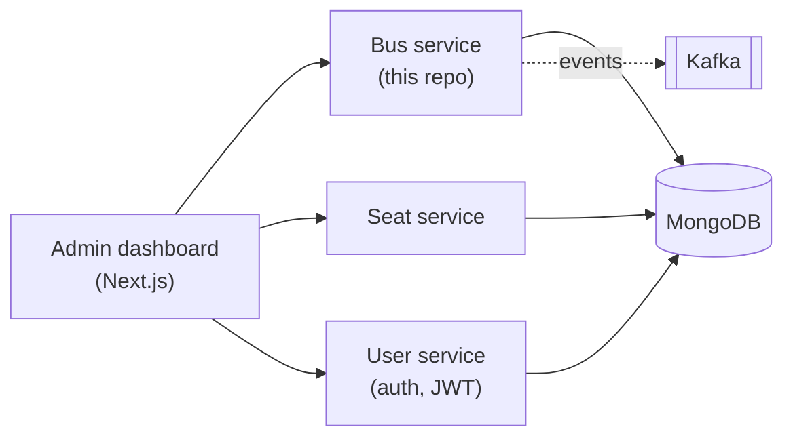

# Bus Tech — Bus Service

The bus fleet microservice of **Bus Tech**, an automated bus scheduling and operations platform
that won **Smart India Hackathon 2024**. This service manages buses, their capacity and occupancy,
and route assignment.


[](https://github.com/naksh1414/Bus-tech-bus/actions/workflows/ci.yml)

## Part of the Bus Tech platform



| Repository | Role |
| --- | --- |
| **Bus-tech-bus** (this repo) | Bus fleet, capacity and route assignment |
| [Bus-tech-seat](https://github.com/naksh1414/Bus-tech-seat) | Seat allocation |
| [Bus-tech-user](https://github.com/naksh1414/Bus-tech-user) | Users, authentication and roles |
| [Bus-tech-Admin](https://github.com/naksh1414/Bus-tech-Admin) | Admin dashboard |

## API

| Method | Path | Description |
| --- | --- | --- |
| `POST` | `/buses` | Register a bus |
| `GET` | `/buses/available` | Buses that still have free capacity |
| `GET` | `/buses/all` | All buses |
| `GET` | `/buses/:id` | One bus |
| `PATCH` | `/buses/route` | Assign or change a bus's route |

A bus tracks `busNumber`, `capacity`, `currentOccupancy`, `currentRoute` and a `status` of
`AVAILABLE`, `PARTIALLY_OCCUPIED` or `FULLY_OCCUPIED`. The status is derived from occupancy
by [`statusForOccupancy`](src/utils/occupancy.ts), which also rejects occupancy that is
negative or above the bus's capacity.

## Structure

The service is layered so HTTP, business logic and persistence stay separate:

```
src/
├── routes/        # Express routes
├── controllers/   # HTTP request/response handling
├── services/      # business rules (occupancy, status, routing)
├── repositories/  # MongoDB access via Mongoose
├── models/        # Mongoose schemas
└── config/        # database and Kafka clients
```

A Kafka client is configured in `src/config/kafka.ts` for event-driven communication between
the platform's services.

## Run it locally

Requires Node.js 18+ and Docker.

```bash
git clone https://github.com/naksh1414/Bus-tech-bus.git
cd Bus-tech-bus
cp .env.example .env        # set MONGODB_URI, PORT, KAFKA_BROKER

# with Docker (starts the service and a local MongoDB)
docker compose up --build

# or without Docker
npm install
npm run dev
```

The service listens on `http://localhost:8008`.

## Tests

```bash
npm test        # unit tests (Node test runner + ts-node)
npm run typecheck
```

Tests run on every push via GitHub Actions.

## Configuration

| Variable | Default | Purpose |
| --- | --- | --- |
| `PORT` | `8008` | HTTP port |
| `MONGODB_URI` | `mongodb://localhost:27017/bus_service` | MongoDB connection string |
| `KAFKA_BROKER` | `0.0.0.0:9092` | Kafka broker address |

Secrets are read from the environment and are never committed.

## Author

Nakshatra Manglik · [nakshatramanglik14@gmail.com](mailto:nakshatramanglik14@gmail.com) ·
[GitHub](https://github.com/naksh1414)
